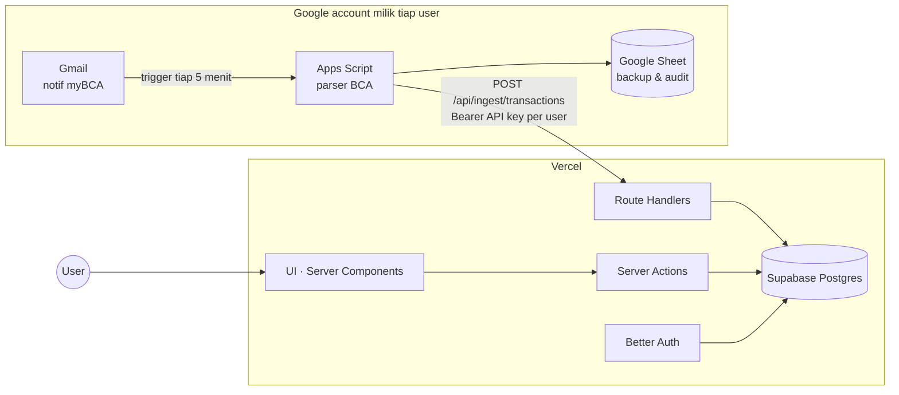
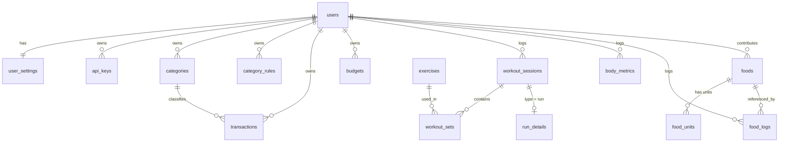

# Cove — Blueprint v2

Personal dashboard multi-user dengan dua modul: **Finance** (auto-tracking pengeluaran dari email BCA + input manual) dan **Fitness** (angkat beban, lari, protein harian). Tema dark, minimalist, elegan. UI berbahasa Inggris.

---

## 1. Tech Stack

| Layer | Pilihan | Alasan |
|---|---|---|
| Framework | **Next.js 16 (App Router, Cache Components, Turbopack) + TypeScript** | Frontend + backend dalam satu repo. Auth guard pakai `proxy.ts` (pengganti middleware di v16) |
| Styling | **Tailwind CSS v4 + shadcn/ui** (dikustom) | Komponen accessible (Radix), mudah dibuat minimalis |
| Animasi | **Motion** | Micro-interaction halus |
| Chart | **Recharts** | Ringan, mudah di-styling dark |
| Database | **Supabase Postgres** (free tier) | Dipakai **hanya sebagai Postgres**, bukan Supabase Auth/SDK |
| ORM | **Drizzle ORM** + drizzle-kit migrations | Type-safe, migrasi versioned |
| Auth | **Better Auth** (email + password) | Tabel auth di DB kita sendiri, rate limit & session built-in |
| Email transaksional | **Resend** (free tier) | Verifikasi email & reset password (opsional, lihat §10) |
| Validasi | **Zod** | Satu schema untuk form, API, webhook |
| Form | React Hook Form + Zod | |
| Integrasi | **Google Apps Script** per user (Gmail → Sheet → Cove) | |
| Testing | Vitest + Playwright | |
| Deploy | **Vercel** (app) + **Supabase** (DB) | |

---

## 2. Arsitektur



**Database Cove = source of truth.** Sheet = log mentah/backup di Google Drive masing-masing user.

### Multi-user & integrasi email
Setiap user memasang Apps Script **di akun Google mereka sendiri** (Cove tidak pernah minta akses Gmail, jadi lebih aman dan tidak perlu verifikasi OAuth dari Google). Alurnya:
1. User buka `/settings/integrations`, klik **Generate key**, lalu Cove menampilkan `keyId` + `secret` (sekali saja).
2. Cove menampilkan kode Apps Script yang sudah terisi URL dan key, user tinggal copy → paste ke script.google.com → jalankan `setup()` sekali (membuat Sheet, label Gmail, dan trigger).
3. Halaman integrations menampilkan status: last sync, jumlah transaksi masuk, error terakhir.

### Alur ingest
_Diimplementasikan di Fase 4 (berbeda dari rencana awal, lihat catatan)._

1. Apps Script search Gmail: `from:bca.co.id "through myBCA" after:<watermark - 15 menit>`. Watermark disimpan di Script Properties; first run mundur 30 hari.
2. POST batch (≤ 25 email) ke `/api/ingest/transactions` dengan `Authorization: Bearer cove_<keyId>_<secret>`. Body berisi **email mentah** (plain text).
3. **Parsing di server** (`src/features/ingest/bca-parser.ts`), jadi perbaikan parser langsung berlaku untuk semua user tanpa paste ulang script.
4. Insert dengan unique `(user_id, external_id)` (`bca:<Reference No.>`), jadi **idempotent**: email yang terkirim ulang jadi `duplicate`.
5. Watermark baru maju setelah Cove menerima batch; kalau gagal, di-retry run berikutnya.
6. Hasil (`imported` / `skipped` / `unparsed`) dicatat di Google Sheet `Cove · myBCA log`.
7. Auto-kategori lewat `category_rules` (merchant mengandung teks → kategori, pattern terpanjang menang).

**Catatan perubahan dari rencana awal:**
- **Bearer token, bukan HMAC.** HMAC mengharuskan server menyimpan secret dalam bentuk yang bisa dibaca. Dengan bearer token, server cukup menyimpan SHA-256 dari secret (192-bit acak) dan transport sudah TLS. Replay tidak berbahaya karena insert idempotent.
- **Watermark, bukan label Gmail.** Label Gmail berlaku per *thread*, dan email BCA bisa tergabung dalam satu thread, sehingga email baru di thread berlabel akan terlewat.

---

## 3. Parser Email BCA

Yang diambil: **tanggal, payment to, total**. Sisanya (location, type, reference) disimpan sebagai metadata.

| Field | Regex (multiline) | Contoh hasil |
|---|---|---|
| status | `/Status\s*:\s*(.+)/` | `Successful` |
| date | `/Transaction Date\s*:\s*(\d{1,2} \w{3} \d{4} \d{2}:\d{2}:\d{2})/` | `18 Oct 2026 11:03:58` → ISO dengan zona `Asia/Jakarta` |
| type | `/Transaction Type\s*:\s*(.+)/` | `QRIS Payment` |
| merchant | `/Payment to\s*:\s*(.+)/` | `ELOX JUS SENTUL` |
| location | `/Merchant Location\s*:\s*(.+)/` | `BOGOR, 16128, ID` |
| amount | `/Total Payment\s*:\s*IDR\s*([\d,]+)\.\d{2}/` | `12,000.00` → `12000` |
| external_id | `/Reference No\.\s*:\s*(\S+)/` | fallback ke Gmail `messageId` |

- Nominal disimpan sebagai **integer rupiah** (bigint), bukan float.
- Merchant dinormalisasi (trim, title case untuk tampilan, uppercase untuk matching rules).
- Parser dibuat modular (`parsers/bca-qris.gs`) supaya format lain (transfer, virtual account, debit) bisa ditambah nanti. **Butuh contoh email untuk tipe selain QRIS** kalau mau ikut tercatat.
- Email yang gagal di-parse diberi label `cove/unparsed` dan dicatat di Sheet, tidak dibuang diam-diam.

---

## 4. Data Model



### Auth (Better Auth)
- `users` — id, name, email (unique), email_verified, image, **role** (`user` | `admin`), created_at
- `sessions`, `accounts` (password hash), `verifications`

### Settings & integrasi
- `user_settings` — user_id, currency (`IDR`), timezone (`Asia/Jakarta`), daily_protein_target_g, monthly_budget, distance_unit (`km`)
- `api_keys` — id, user_id, name, key_id, secret_hash, last_used_at, last_error, revoked_at

### Finance
- `categories` — id, user_id, name, icon, color, type (`expense` | `income`). Default di-seed saat register (Food & Drinks, Transport, Shopping, Bills, Entertainment, Health, Salary, Other).
- `category_rules` — id, user_id, pattern, category_id, priority
- `transactions` — id, user_id, **type** (`expense` | `income`), amount (bigint), merchant, description, category_id, **source** (`email` | `manual`), provider (`bca`), external_id, metadata (jsonb), occurred_at, created_at
  - unique `(user_id, external_id)`, index `(user_id, occurred_at desc)`
- `budgets` — id, user_id, category_id (null = total), month, amount

### Fitness: angkat beban & lari
- `exercises` — id, created_by (null = bawaan), name, muscle_group, equipment, is_public
- `workout_sessions` — id, user_id, **type** (`strength` | `run`), title, started_at, duration_s, rpe, notes
- `workout_sets` — id, session_id, exercise_id, set_order, weight_kg (numeric), reps, rpe, is_warmup
- `run_details` — session_id (PK), distance_m, duration_s, run_type (`easy` | `tempo` | `interval` | `long` | `race`), avg_hr, max_hr, elevation_gain_m, cadence, surface (`road` | `treadmill` | `trail` | `track`), shoe (opsional)
- `body_metrics` — id, user_id, date, weight_kg, body_fat_pct

Metrik turunan (dihitung saat query):
- **Strength:** volume = Σ(weight × reps), estimasi 1RM (Epley), PR per exercise, volume per muscle group per minggu
- **Run:** pace (min/km) = duration / distance, total km per minggu/bulan, PR (fastest 1K/5K/10K, longest run), tren pace
- **Umum:** streak latihan, kalender aktivitas

### Nutrition: database makanan bersama (shared)
- `foods` — id, name, name_normalized, brand (opsional), **protein_per_100g**, calories_per_100g, carbs_per_100g, fat_per_100g, created_by (null = seed), **status** (`verified` | `community` | `private`), usage_count, created_at
- `food_units` — id, food_id, label (`g`, `piece`, `slice`, `cup`, `scoop`, `tbsp`), **grams_per_unit**, is_default
  - Telur: `piece = 55 g` (default). Dada ayam: `g = 1` (default). Whey: `scoop = 30 g`.
- `food_logs` — id, user_id, food_id, unit_id, quantity, **protein_g (snapshot)**, calories (snapshot), meal (`breakfast` | `lunch` | `dinner` | `snack`), logged_at

**Kalkulasi:** `protein_g = quantity × grams_per_unit × protein_per_100g / 100`. Contoh 3 butir telur: 3 × 55 × 12.6 / 100 = **20.8 g**. Nilai disimpan sebagai snapshot supaya log lama tidak berubah kalau data makanan dikoreksi.

**Database makanan yang terus bertambah:**
- Seed awal sekitar 100 makanan umum Indonesia dan gym staples (telur, dada ayam, paha ayam, daging sapi, ikan nila, salmon, tuna kaleng, udang, tahu, tempe, nasi putih, nasi merah, oat, susu, greek yogurt, whey, kacang, dll.) dengan status `verified`.
- Makanan baru dari user langsung bisa dipakai oleh pembuatnya dan **langsung muncul untuk semua user** dengan badge "Community".
- Anti-duplikat: saat menambah makanan, Cove menampilkan saran yang mirip (Postgres `pg_trgm` similarity) sebelum user membuat entri baru.
- Admin bisa memverifikasi, mengedit, atau menggabungkan duplikat di `/admin/foods`.
- Pencarian diurutkan: verified → paling sering dipakai → paling mirip. Ditambah "Recent" & "Favorites" per user untuk input cepat.
- Validasi sanity: protein per 100g ≤ 100, protein×4 + carbs×4 + fat×9 tidak jauh melebihi kalori.

---

## 5. Struktur Halaman

```
/                         Landing (hero + login CTA)
/login /register          Auth
/forgot-password          (jika Resend aktif)

/dashboard                Spending bulan ini, sisa budget, protein hari ini, aktivitas minggu ini

/finance                  Overview: income vs expense, chart harian, breakdown kategori
/finance/transactions     Tabel + filter, edit kategori inline, tambah manual (income/expense)
/finance/budgets          Budget per kategori
/finance/rules            Aturan auto-kategori

/fitness                  Overview: streak, kalender aktivitas, volume & km mingguan, berat badan
/fitness/log/strength     Logger angkat beban (mobile-first, input set cepat, rest timer)
/fitness/log/run          Form lari (distance, duration, pace otomatis)
/fitness/history          Riwayat semua sesi
/fitness/exercises/[id]   Progress per exercise: 1RM, volume, PR
/fitness/running          Progress lari: km per minggu, tren pace, PR
/fitness/nutrition        Log protein hari ini: ring vs target, per meal
/fitness/foods            Cari & tambah makanan

/settings                 Profil, password, target protein, budget, timezone
/settings/integrations    API key + kode Apps Script siap copy + status sync
/admin/foods              Moderasi makanan (role admin)
```

API: `POST /api/ingest/transactions` (Bearer API key), `/api/auth/*` (Better Auth). Mutasi lain lewat Server Actions, semua di-scope `user_id` dari session.

---

## 6. Design System

**Prinsip:** banyak whitespace, hierarki lewat tipografi, satu warna aksen, border tipis tanpa shadow, animasi ≤ 200ms.

| Token | Nilai |
|---|---|
| `bg` | `#0A0A0B` |
| `surface` | `#111113` |
| `surface-2` | `#18181B` |
| `border` | `#232326` |
| `text` | `#EDEDEF` |
| `text-muted` | `#8B8B93` |
| `accent` | `#C8B88A` |
| `positive` | `#6FCF97` |
| `negative` | `#EB5757` |

- Font: Geist Sans (UI), Geist Mono + `tabular-nums` (nominal, berat, pace).
- Skala: 12 / 14 / 16 / 20 / 28 / 40 px. Radius 10px (card), 8px (input).
- Layout: sidebar ramping di desktop, bottom nav di mobile, max-width 1200px.
- Komponen inti: StatCard, Sparkline, ProgressRing, DataTable, EmptyState, CommandMenu (⌘K: quick add transaksi/makanan/workout).
- Format: `Rp 12.000` untuk nominal (locale `id-ID`) walau UI Inggris; tanggal `18 Oct 2026`.
- A11y: kontras ≥ 4.5:1, focus ring terlihat, navigasi keyboard, `prefers-reduced-motion`.

---

## 7. Keamanan

- Password di-hash oleh Better Auth; cookie session `HttpOnly`, `Secure`, `SameSite=Lax`.
- Cookie cache Better Auth **dimatikan**: sesi yang di-sign-out atau dicabut (ganti password) langsung tidak berlaku. Ditukar dengan satu query sesi per request.
- `proxy.ts` hanya cek keberadaan cookie (redirect cepat); validasi sesi sesungguhnya di layout `(app)` dan di setiap Server Action lewat `requireUser()`.
- Rate limit login/register/ingest.
- Semua query difilter `user_id` dari session (helper `requireUser()`); admin route dicek `role`.
- Ingest: bearer API key per user (maks 5 aktif), hanya SHA-256 secret yang disimpan, dibandingkan timing-safe, bisa di-revoke. Body maks 1 MB / 50 email. Metadata transaksi tidak menyimpan nomor rekening, PAN, atau RRN.
- **Supabase:** app konek langsung via Postgres (bukan Data API). RLS di-enable di semua tabel tanpa policy, sehingga anon key Supabase tidak bisa membaca data apa pun.
- Konten makanan dari user di-escape (React default) dan divalidasi Zod; ada batas jumlah makanan baru per user per hari.
- Secret hanya di env var (`.env.local` di-gitignore, env Vercel untuk production).

---

## 8. Struktur Folder

```
cove/
├─ src/
│  ├─ app/
│  │  ├─ (marketing)/  (auth)/  (app)/  admin/
│  │  └─ api/ auth/[...all]/  ingest/transactions/
│  ├─ components/ ui/ charts/ layout/
│  ├─ features/
│  │  ├─ finance/    actions.ts queries.ts schemas.ts components/
│  │  ├─ workouts/   ...
│  │  ├─ running/    ...
│  │  └─ nutrition/  ...
│  ├─ db/ schema/*.ts  index.ts  seed/ (foods, exercises, categories)
│  ├─ lib/ auth.ts auth-client.ts hmac.ts format.ts units.ts
│  └─ styles/globals.css
├─ apps-script/ Code.gs  parsers/bca-qris.gs  README.md
├─ drizzle/      (migrations)
└─ tests/
```

---

## 9. Rencana Eksekusi

| Fase | Isi | Hasil |
|---|---|---|
| **1. Foundation** | Scaffold Next.js, Tailwind, design tokens, shadcn, font, layout app, landing | Shell aplikasi dark yang bisa dinavigasi |
| **2. Database & Auth** | Setup Supabase, Drizzle, Better Auth, login/register, route guard, seed kategori per user, settings | Multi-user login berfungsi |
| **3. Finance core** | CRUD transaksi income/expense, kategori, overview + chart, filter | Finance manual berfungsi |
| **4. Email integration** | API key (bearer), endpoint ingest + parser server-side, Apps Script BCA, category rules, halaman integrations | Pengeluaran BCA tercatat otomatis |
| **5. Strength training** | Exercise library + seed, logger sesi, riwayat, progress & PR | Catat & pantau angkat beban |
| **6. Running** | Form lari, progress km/pace, PR, kalender aktivitas gabungan | Catat & pantau lari |
| **7. Nutrition** | Seed makanan, units, log protein, target, community foods + anti-duplikat, admin moderasi, body weight | Tracking protein harian |
| **8. Dashboard & polish** | Dashboard gabungan, ⌘K, empty/loading states, budget, responsive & a11y pass | UX lengkap |
| **9. Hardening & deploy** | Rate limit, test, deploy Vercel + Supabase, panduan setup | Live di production |

---

## 10. Panduan Setup Supabase + Vercel (untuk Fase 2 & 9)

1. Buat akun di supabase.com → **New project** → region **Southeast Asia (Singapore)** → simpan database password.
2. **Project Settings → Database → Connection string**: ambil dua URL:
   - **Transaction pooler** (port `6543`) → `DATABASE_URL` (dipakai app di Vercel; wajib `prepare: false` di driver).
   - **Session pooler** (host sama, port `5432`) → `DIRECT_URL` (dipakai drizzle-kit untuk migrasi). Jangan pakai host direct `db.<ref>.supabase.co`: di free tier host itu IPv6-only dan tidak bisa diakses dari banyak jaringan.
   - Cek koneksi kapan saja dengan `npm run db:check`.
3. Taruh di `.env.local` (tidak di-commit). Di Vercel: **Project → Settings → Environment Variables**.
4. Catatan free tier: project Supabase **di-pause setelah 7 hari tanpa aktivitas**. Apps Script yang sync tiap 5 menit otomatis menjaga project tetap aktif. Limit DB 500 MB, lebih dari cukup.
5. Resend (opsional): verifikasi email/reset password ke alamat orang lain butuh **domain sendiri**. Tanpa domain, fitur ini bisa ditunda dan login tetap jalan.
